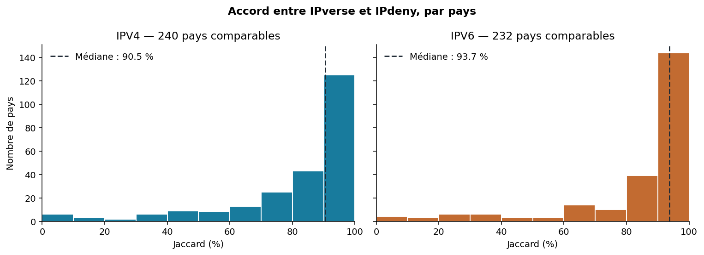
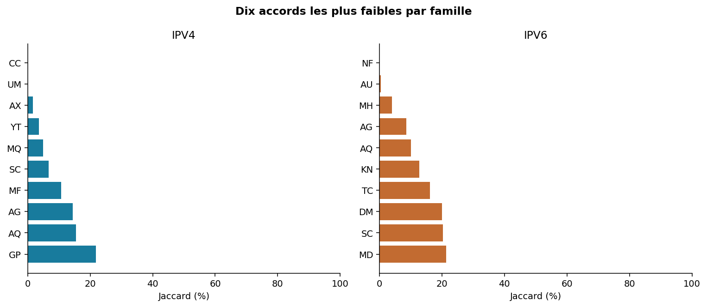
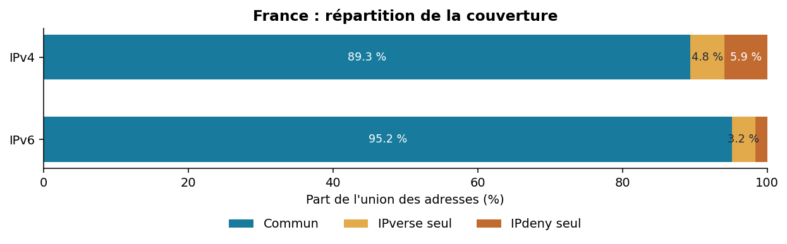

# nginx-country

Des fichiers Nginx par pays, prêts à être inclus, ainsi qu'un outil Python pour les régénérer à partir d'IPverse, d'IPdeny et de GeoLite.

> La géolocalisation par adresse IP est indicative : elle ne permet pas de garantir la localisation réelle d'un visiteur. Tester la configuration avant toute mise en production.

## Utiliser les fichiers déjà fournis

Le répertoire [`nginx-country/`](nginx-country) contient un fichier `XX-allow.conf` et un fichier `XX-deny.conf` pour chaque pays (par exemple `FR-allow.conf`). Les fichiers ne modifient pas Nginx et n'ajoutent jamais `deny all`.

Sous Linux, récupérer l'intégralité du dépôt :

```bash
git clone https://github.com/CultureLinux/nginx-country.git
cd nginx-country
```

Ou, sans Git :

```bash
curl -L https://github.com/CultureLinux/nginx-country/archive/refs/heads/main.tar.gz \
  | tar -xz
cd nginx-country-main
```

### Contenu des fichiers

Chaque pays a deux fichiers qui combinent trois sources (IPverse, IPdeny, GeoLite) :

| Fichier | Directive | Contenu |
| --- | --- | --- |
| `XX-allow.conf` | `allow` | **Union** des sources : toute adresse attribuée au pays par au moins une source. |
| `XX-deny.conf` | `deny` | **Intersection** des sources : uniquement les adresses sur lesquelles les trois sources sont d'accord. |

`XX-deny.conf` n'est donc pas le complément de `XX-allow.conf` : c'est la liste la plus sûre pour bloquer un pays en limitant les faux positifs, mais elle laisse passer les adresses contestées. Pour n'autoriser qu'un pays, utiliser `allow` suivi de `deny all;`.

Quand une source ne publie pas une famille IP pour un pays (par exemple IPdeny sans IPv6 pour `BV`), la famille est dite **partielle** : `allow` utilise les sources disponibles, afin de ne jamais bloquer cette famille, et `deny` n'est pas émis pour elle. Le statut de chaque pays et famille (`complete`, `partial`, `absent`) est consigné dans [`nginx-country/manifest.json`](nginx-country/manifest.json).

Les fichiers peuvent être volumineux pour certains pays (plusieurs dizaines de milliers de lignes, surtout en IPv6, par exemple `AU-allow.conf`) : IPverse publie des préfixes très fins, repris tels quels dans l'union. Nginx évalue `allow` et `deny` séquentiellement, ce qui coûte à chaque requête ; limitez le nombre de pays inclus.

Exemples d'inclusion :

```nginx
# N'autoriser que la France.
include /chemin/vers/nginx-country/nginx-country/FR-allow.conf;
deny all;
```

```nginx
# Bloquer un pays, autoriser le reste.
include /chemin/vers/nginx-country/nginx-country/RU-deny.conf;
allow all;
```

Validez toujours la configuration avant rechargement :

```bash
sudo nginx -t
```

## Publier une archive

Créer puis pousser un tag pour publier automatiquement une release GitHub contenant uniquement `nginx-country/` :

```bash
git tag v1.0.0
git push origin v1.0.0
```

La release contient `nginx-country-v1.0.0.tar.gz`. Un tag avec suffixe, par exemple `v1.0.0-rc.1`, crée une pré-release.

## Générer ses propres données

Prérequis : Python 3.9+, un accès HTTPS et un compte gratuit [MaxMind GeoLite2](https://www.maxmind.com/en/geolite2/signup). Générer une clé de licence dans *Account → Manage license keys*, puis la renseigner dans un fichier `.env` (ignoré par git) :

```bash
cp .env.example .env
# éditer .env : MAXMIND_ACCOUNT_ID et MAXMIND_LICENSE_KEY
```

Tout mettre à jour en une commande (collecte des trois sources, génération, fichiers publiés) :

```bash
PYTHONPATH=src python3 -m nginx_country update
```

Ou étape par étape :

```bash
# 1. Télécharger IPverse et IPdeny (peut prendre quelques minutes), puis GeoLite.
PYTHONPATH=src python3 -m nginx_country collect
PYTHONPATH=src python3 -m nginx_country collect-geolite

# 2. Générer les règles de chaque source dans generated/.
PYTHONPATH=src python3 -m nginx_country generate

# 3. Produire les fichiers publiés (union / intersection) dans nginx-country/.
PYTHONPATH=src python3 -m nginx_country build-combined
```

Les données brutes sont enregistrées dans `data/raw/` (la dernière archive GeoLite est utilisée automatiquement ; les anciennes sont supprimées, conformément à la licence MaxMind) et les générations dans `generated/`. Pour ne collecter qu'un pays : `collect FR`. `update --skip-fetch` régénère à partir des données déjà téléchargées.

La clé MaxMind n'est lue que dans `.env` ou dans les variables d'environnement (qui sont prioritaires) ; elle n'est jamais affichée.

Par défaut, les plages spéciales (privées, réservées…) sont conservées. Pour les exclure lors de la génération : `generate --special exclude` (la fusion `build-combined` exige la politique `keep`).

Chaque source est traitée indépendamment : une erreur préserve la dernière génération valide de l'autre source. Consultez les options avec `PYTHONPATH=src python3 -m nginx_country <commande> --help`.

## Mise à jour des données

Les données publiées sont régénérées manuellement avec `update` ; aucune mise à jour automatique n'existe pour l'instant (pas de tâche planifiée ni de pull request automatique). La date de génération et les révisions des sources figurent dans `nginx-country/manifest.json`. Une automatisation (workflow planifié) est une piste ultérieure, non traitée ici.

## Comparer les sources

La comparaison indique, par pays et par famille IP, les adresses communes et les écarts entre IPverse et IPdeny :

```bash
PYTHONPATH=src python3 -m nginx_country compare > comparaison.json
PYTHONPATH=src python3 -m nginx_country compare --country FR
```

Instantané du 23 octobre 2026, sur 249 pays ou territoires :

| Indicateur | IPv4 | IPv6 |
| --- | ---: | ---: |
| Pays comparables | 240 | 232 |
| Accord médian (Jaccard) | 90,5 % | 93,7 % |
| Pays sous 50 % d'accord | 26 | 22 |







L'indice de Jaccard mesure l'accord entre les deux listes (`intersection / union`) ; ce n'est pas un taux d'exactitude géographique. Les sources peuvent partager les mêmes erreurs et certaines familles IP sont absentes pour certains pays.

Pour les détails de collecte, les limites des sources et les comparaisons avec GeoLite, voir le [cadrage des sources](docs/cadrage-sources.md) et la commande `compare-three` (`PYTHONPATH=src python3 -m nginx_country compare-three --help`).

## Vérifier le projet

```bash
PYTHONPATH=src python3 -m unittest discover -s tests -v
```
