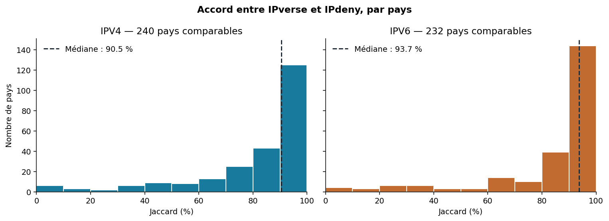
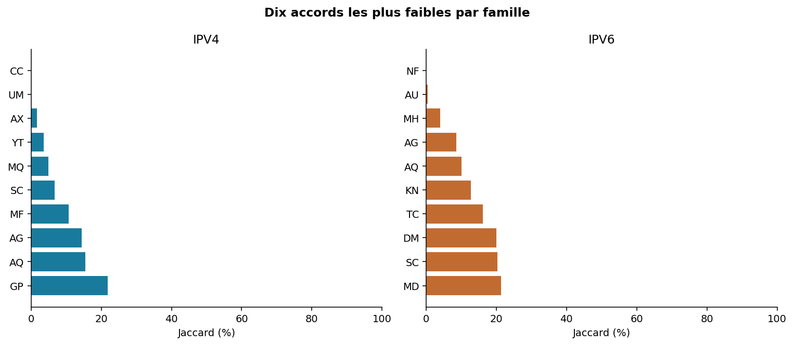
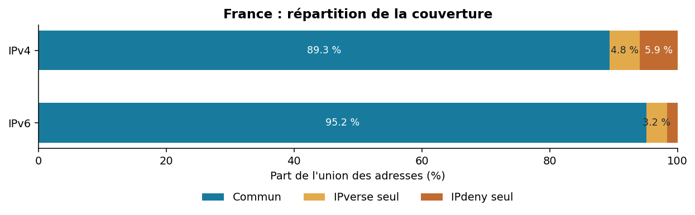

# nginx-country

Des fichiers Nginx par pays, prêts à être inclus, ainsi qu'un outil Python pour les régénérer à partir d'IPverse et d'IPdeny.

> La géolocalisation par adresse IP est indicative : elle ne permet pas de garantir la localisation réelle d'un visiteur. Tester la configuration avant toute mise en production.

## Utiliser les fichiers déjà fournis

Le répertoire [`nginx-country/`](nginx-country) contient un fichier `XX-allow.conf` et un fichier `XX-deny.conf` pour chaque pays (par exemple `FR-allow.conf`). Les fichiers ne modifient pas Nginx et n'ajoutent jamais `deny all`.

Sous Linux, récupérer l'intégralité du dépôt :

```bash
git clone https://github.com/CultureLinux/nginx-country.git
cd nginx-country
```

Ou, sans Git :

```bash
curl -L https://github.com/CultureLinux/nginx-country/archive/refs/heads/main.tar.gz \
  | tar -xz
cd nginx-country-main
```

Exemple d'inclusion dans un bloc Nginx adapté à votre politique :

```nginx
include /chemin/vers/nginx-country/nginx-country/FR-allow.conf;
deny all;
```

Validez toujours la configuration avant rechargement :

```bash
sudo nginx -t
```

## Publier une archive

Créer puis pousser un tag pour publier automatiquement une release GitHub contenant uniquement `nginx-country/` :

```bash
git tag v1.0.0
git push origin v1.0.0
```

La release contient `nginx-country-v1.0.0.tar.gz`. Un tag avec suffixe, par exemple `v1.0.0-rc.1`, crée une pré-release.

## Générer ses propres données

Prérequis : Python 3.9+ et un accès HTTPS. Depuis la racine du dépôt :

```bash
# Télécharger les données de tous les pays (peut prendre quelques minutes).
PYTHONPATH=src python3 -m nginx_country

# Générer les fichiers Nginx à partir des données téléchargées.
PYTHONPATH=src python3 -m nginx_country generate
```

Les données brutes sont enregistrées dans `data/raw/` et les générations dans `generated/`. Pour ne collecter qu'un pays :

```bash
PYTHONPATH=src python3 -m nginx_country FR
PYTHONPATH=src python3 -m nginx_country generate
```

Par défaut, les plages spéciales sont conservées. Pour les exclure lors de la génération :

```bash
PYTHONPATH=src python3 -m nginx_country generate --special exclude
```

Chaque source est traitée indépendamment : une erreur préserve la dernière génération valide de l'autre source. Consultez les options disponibles avec `--help`.

## Comparer les sources

La comparaison indique, par pays et par famille IP, les adresses communes et les écarts entre IPverse et IPdeny :

```bash
PYTHONPATH=src python3 -m nginx_country compare > comparaison.json
PYTHONPATH=src python3 -m nginx_country compare --country FR
```

Instantané du 23 octobre 2026, sur 249 pays ou territoires :

| Indicateur | IPv4 | IPv6 |
| --- | ---: | ---: |
| Pays comparables | 240 | 232 |
| Accord médian (Jaccard) | 90,5 % | 93,7 % |
| Pays sous 50 % d'accord | 26 | 22 |







L'indice de Jaccard mesure l'accord entre les deux listes (`intersection / union`) ; ce n'est pas un taux d'exactitude géographique. Les sources peuvent partager les mêmes erreurs et certaines familles IP sont absentes pour certains pays.

Pour les détails de collecte, les limites des sources et les comparaisons avec GeoLite, voir le [cadrage des sources](docs/cadrage-sources.md) et les commandes `compare-three` et `build-combined` via `PYTHONPATH=src python3 -m nginx_country <commande> --help`.

## Vérifier le projet

```bash
PYTHONPATH=src python3 -m unittest discover -s tests -v
```
